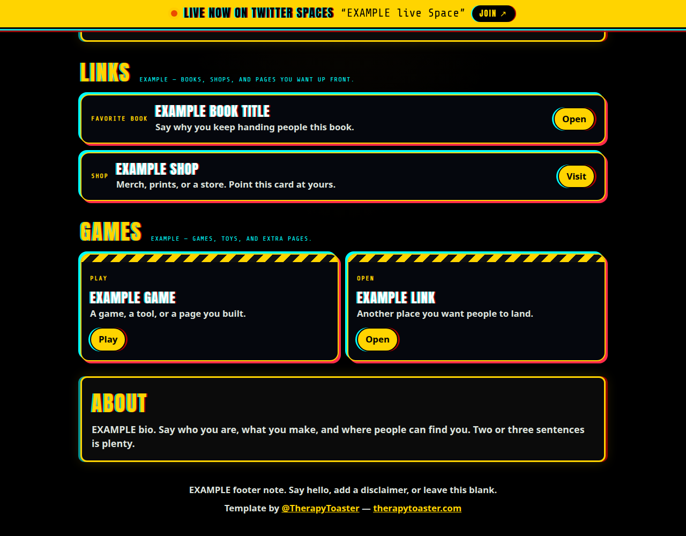
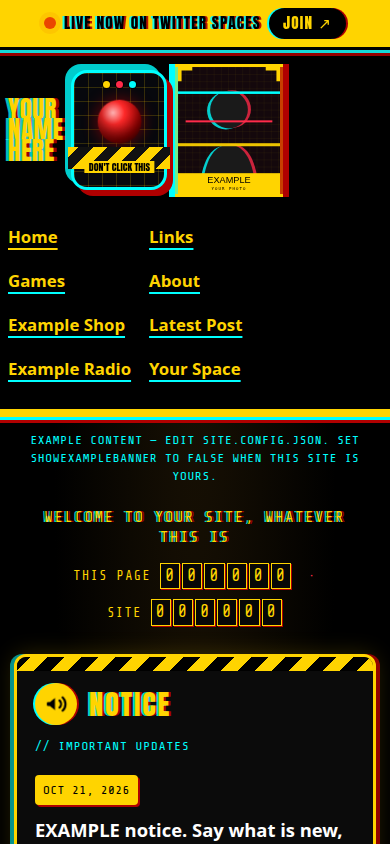

# Yellow-and-black personal site

A glitchy personal site in the style of [therapytoaster.com](https://www.therapytoaster.com): X-yellow `#FFD400`, black, cyan and red text accents, hazard-tape stripes. Click **Use this template**, edit one file, and publish free on GitHub Pages. No install and no build.





The yellow bar in the screenshots is the live-Space preview (`?live=1`). On your site it stays hidden until you are actually live.

## Use this template

1. Click **Use this template**, then **Create a new repository**. Pick a name. `yourname.github.io` becomes a user site at the root of that domain. Any other name becomes a project site at `https://yourname.github.io/repo-name/`.
2. On GitHub, open `site.config.json` and click the pencil. Replace the EXAMPLE values. Commit to `main`.
3. Turn on Pages: **Settings → Pages → Build and deployment → Source: GitHub Actions**. The included workflow publishes `main`. Give it a minute, then open the URL shown on that settings page. If the first run does not start, open the **Actions** tab, choose **Deploy GitHub Pages**, and click **Run workflow**. New repositories sometimes ask you to enable Actions once. Do that if GitHub shows the button.

That is the whole setup. The rest of this file is for when you want to change a section or turn on the live bar.

## What you edit

Everything visitors see comes from [`site.config.json`](site.config.json). Text is plain text. A value that is a link must start with `https://`, or be a relative path like `assets/me.jpg`, or be an on-page link like `#games`.

| You want to change | Key |
| --- | --- |
| Name in the corner and the browser tab | `name` and `nameLines` |
| Yellow line under the header | `tagline` |
| Photo | `avatar.src` and `avatar.alt`. Put a square image in `assets/` and point `src` at it, for example `assets/me.jpg`. |
| Red button | `hero.tape` is the label. `hero.url` is where it goes. Leave `url` blank and the button shows `hero.message`. |
| Yellow link list | `nav`. `current: true` underlines the page you are on. |
| Digit counters | `stats`. These are words you type. They are not a live hit counter. Delete the array to hide them. |
| Notice board | `notices`. Newest date goes on top. A notice from the last 4 days gets a NEW mark. |
| Social row | `socials`. Icon names: `twitter`, `tiktok`, `instagram`, `kick`, `youtube`, `twitch`, `discord`, `github`, `facebook`, `website`. |
| One embedded post | `twitter.latestPostId`. On Twitter, open the post and copy the long number at the end of the link (`twitter.com/name/status/1234567890123456789`). |
| Book, shop, and other wide cards | `links` |
| Games and extra pages | `games` |
| About paragraph | `about`. Leave it blank to hide the section. |
| Footer note | `footer.note` |
| Yellow EXAMPLE strip | Set `showExampleBanner` to `false` when the copy is yours. |

Empty a list (`"links": []`) to hide that section. Links that are not `http` or `https` are dropped, so a bad paste cannot inject a script.

## Preview on your computer

From the project folder:

```bash
python3 -m http.server 8080
```

Open `http://127.0.0.1:8080/`. Opening `index.html` as a file will not load the config.

Add `?live=1` to preview the Twitter Spaces bar. `?live=0` forces it off.

## Twitter Spaces live bar

The bar is fed by [`status.json`](status.json) in this repo. It stays hidden until that file says a Space is live and the timestamp is less than 15 minutes old.

The checker is [`.github/workflows/spaces-live.yml`](.github/workflows/spaces-live.yml). It runs every 5 minutes. It calls `GET https://api.x.com/2/spaces/by/creator_ids` and writes `status.json`. It does nothing unless both of these are set:

1. `spaces.userId` in `site.config.json` — the numeric Twitter user id, not your @handle.
2. A repository secret named exactly `X_BEARER_TOKEN` — a bearer token from the [X developer portal](https://developer.x.com/). **Settings → Secrets and variables → Actions → New repository secret.** Never put the token in a file.

To find the numeric id, from your own computer (the token stays on your machine):

```bash
curl -s -H "Authorization: Bearer YOUR_TOKEN" \
  "https://api.x.com/2/users/by/username/yourhandle"
```

Copy the `id` into `spaces.userId`.

GitHub may not run the schedule until you open the **Actions** tab and enable workflows. You can also run it by hand: **Actions → Twitter Spaces live status → Run workflow**.

If the token is missing, the user id is blank, or Twitter returns an error, the script logs the problem, leaves `status.json` as it was, and exits successfully. A bad response will not mark you offline and will not fail the workflow.

While you are live, the checker refreshes `status.json` and publishes the site again, so the bar can turn on without you pushing a commit. When the Space ends, the next successful check clears it. If checks stop arriving, the bar hides after 15 minutes so a stuck file cannot say you are live forever.

`spaces.enabled: false` turns the bar off in the browser even if `status.json` says live. `spaces.statusUrl` can point at another `status.json` if you host that file somewhere else. A same-repo `status.json` is the path the workflow updates. `spaces.fallbackUrl` is used when a live Space has no usable link.

Scheduled workflows on GitHub can start a few minutes late when Actions is busy.

## Colors, type, and motion

Colors live at the top of [`css/styles.css`](css/styles.css) as `--yellow`, `--cyan`, `--red`, and the rest. The display face is [Anton](https://fonts.google.com/specimen/Anton) and the counter face is [Share Tech Mono](https://fonts.google.com/specimen/Share+Tech+Mono). Both are under the SIL Open Font License; the license files are in `assets/fonts/`.

Glitch color is a static text shadow (cyan one way, red the other). The live dot and the red button use a slow pulse. Nothing shakes. If the visitor has **prefers-reduced-motion** turned on, those pulses stop.

## Remove the template credit

The footer line **Template by @TherapyToaster — therapytoaster.com** is there so people can find the original. Set `footer.showTemplateCredit` to `false` to remove it, or delete the credit block in `js/site.js`. The MIT license still applies to the code.

## Pages notes

- Paths are relative, so the same files work on a user site (`yourname.github.io`) and a project site (`yourname.github.io/repo`). Prefer `assets/me.jpg` over `/assets/me.jpg`. A leading slash points at the domain root, which skips the repository folder on a project site.
- [`.nojekyll`](.nojekyll) is included so Pages serves the files as they are.
- The Pages workflow copies the site into `_site` and deploys that. README, scripts, and workflow files are not part of the published site.
- Publishing from the `main` branch folder `/` also works, because `index.html` is at the root. Use **GitHub Actions** as the source if you want the Spaces checker to update the live site on its own. A commit made by the checker with the built-in token does not start a separate branch rebuild.

## If you change the checker

The script is [`scripts/check-spaces.js`](scripts/check-spaces.js). It needs Node 18 or newer, which GitHub-hosted runners already have. From this folder:

```bash
node --test
```

## License

[MIT](LICENSE). Copyright (c) 2026 TherapyToaster.

Template by [@TherapyToaster](https://twitter.com/TherapyToaster) — [therapytoaster.com](https://www.therapytoaster.com).
